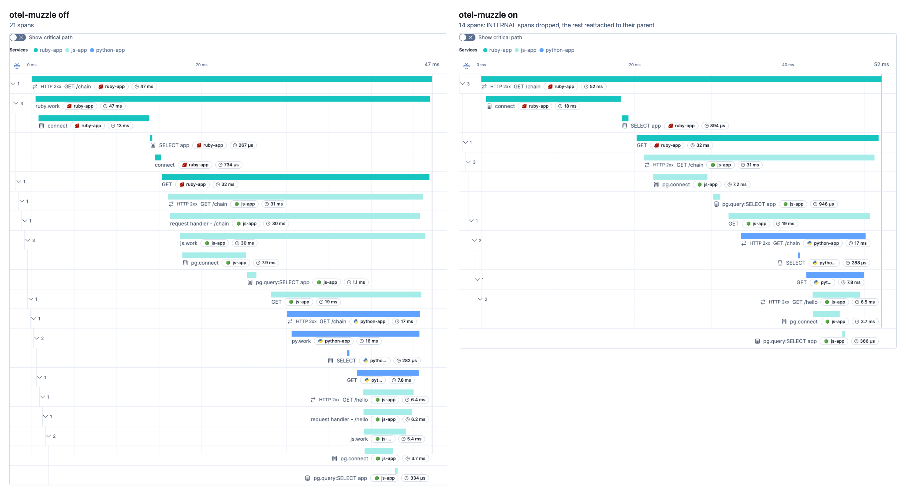
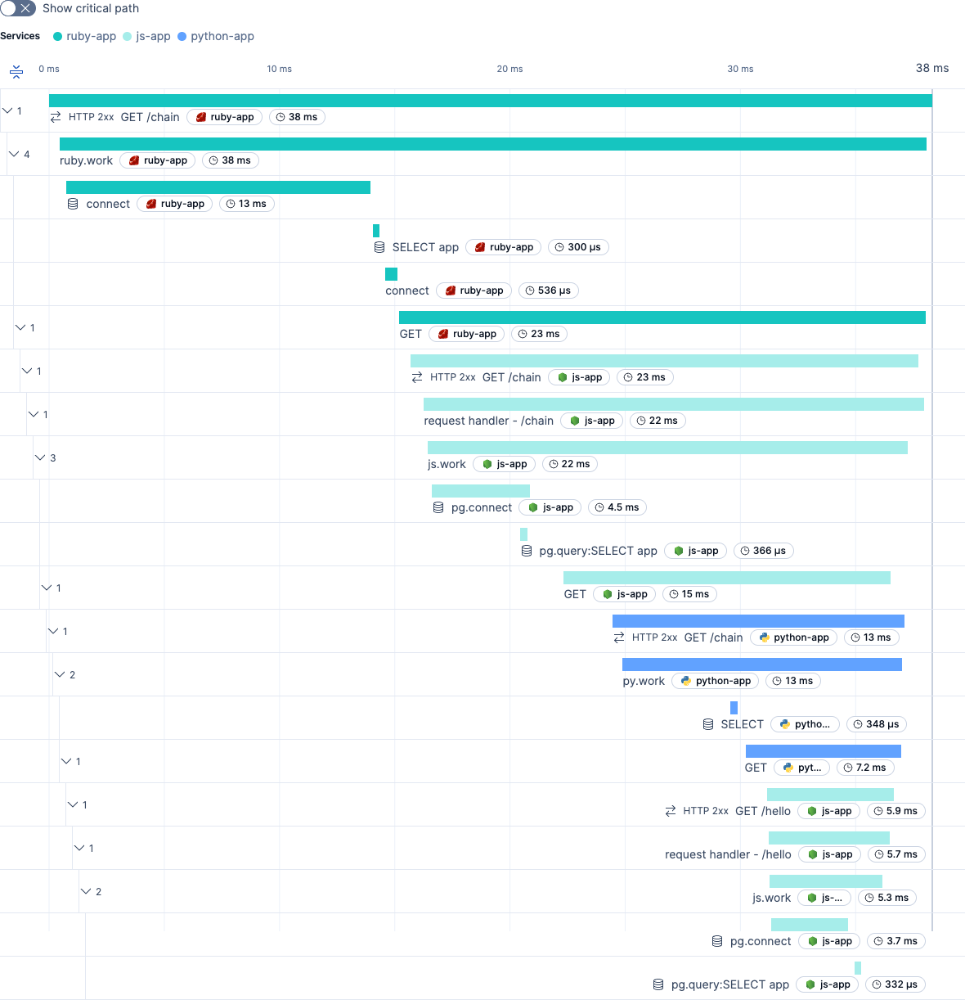
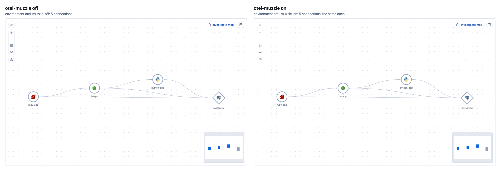

# otel-muzzle in Elastic Observability

The example stack ran twice against an Elastic Observability serverless project, through its OTLP endpoint:
- **`otel-muzzle-off`:** otel-muzzle off;
- **`otel-muzzle-on`:** otel-muzzle on, at the default 10% verbose ratio.

The setup is the same both times: the same three apps, under each language's own zero-code agent. The off run turns
otel-muzzle off with each language's switch:
- Ruby `OTEL_RUBY_INSTRUMENTATION_MUZZLE_ENABLED=false`;
- Python `OTEL_PYTHON_DISABLED_INSTRUMENTATIONS=muzzle`;
- Node.js `@opentelemetry/auto-instrumentations-node/register` in place of the setup file.

The otel-muzzle-on run used `otel-muzzle/register` for Node.js, an entry point since removed in favour of the setup file
in `examples/js-app/instrumentation.js`.

Each run sent 63 requests through ruby-app → js-app → python-app → js-app, each app querying Postgres. Run on
2026-11-07; [the example](..) reproduces it.

## Trace waterfalls

The same request, opened at ruby-app's root transaction:
- **Off:** 21 spans.
- **On:** 14.
  - The seven INTERNAL spans are gone: `ruby.work`, the Ruby `connect`, `request handler` and `js.work` twice, and
    `py.work`.
  - Every Postgres query and HTTP call is still there, attached to its own service's SERVER span.
  - The trace is still one connected tree across the three services.

About one trace in ten stays verbose with otel-muzzle on, picked by trace id the same way in all three languages.
Any request that sends `tracestate: muzzle=verbose` stays verbose too. A verbose trace looks exactly like the off
run:

## Service map

The topology is unchanged in both environments. The connections:
- ruby-app → js-app;
- js-app ⇄ python-app;
- each app → postgresql.

Service maps are built from the spans that cross a boundary (CLIENT, SERVER, and database calls), and otel-muzzle
keeps all of those. It drops only INTERNAL spans whose parent is in the same process.

## What the data says

Read back from Elasticsearch (ES|QL over `traces-*`) for every recorded trace, and from Kibana's service map API,
by `examples/backends/elastic/check.py`:

| Environment | Traces | Full | Lean | Spans per trace | SERVER | CLIENT | INTERNAL |
|---|---:|---:|---:|---:|---:|---:|---:|
| otel-muzzle-off | 63 | 63 | 0 | 21.00 | 4.00 | 10.00 | 7.00 |
| otel-muzzle-on | 63 | 11 | 52 | 15.22 | 4.00 | 10.00 | 1.22 |

- **Header requests:** three of each run's requests sent `tracestate: muzzle=verbose`. With otel-muzzle on, the
  other 8 full traces are the ratio's picks.
- **SERVER and CLIENT spans** per trace are identical. Only INTERNAL spans changed, from 7 per trace to 1.22: the 11
  full traces (8 picked by the ratio, 3 by the header) kept all 7, and the 52 lean ones kept none.
- **Every trace** has all three services and a single root (ruby-app's SERVER span), and every other span's parent
  is in the trace.
  - Every full trace kept INTERNAL spans in every service.
  - No lean trace has any.
- **Service map connections** from `/internal/apm/service-map` are identical in both environments, and so are the
  edges the Kibana UI rendered.

Spans per trace fell 27.5% overall here (21 → 15.22): 33% on lean traces, diluted by the verbose ones. The demo apps
have one INTERNAL span per request each. Services with more middleware, ORM and framework instrumentation save
more. [The benchmark](../../../../bench/RESULTS.md) measures the OpenTelemetry Demo's own services.
